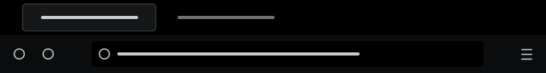
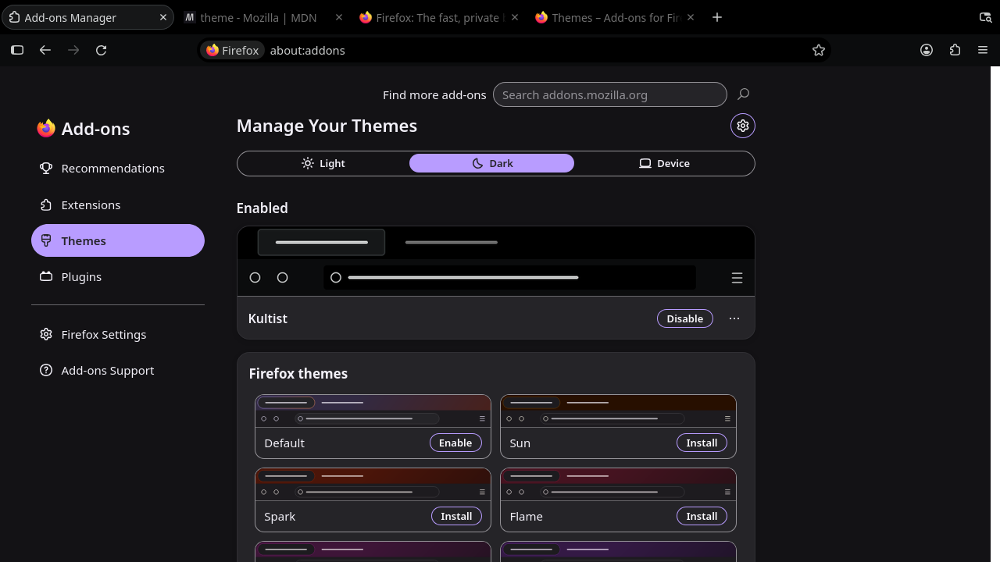
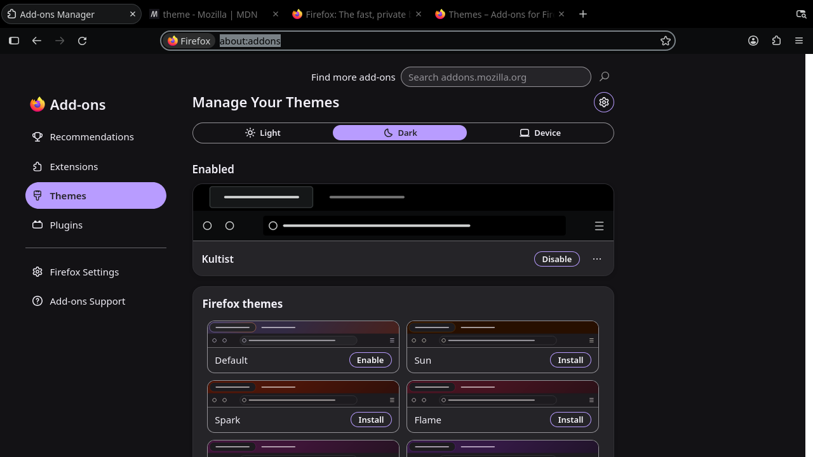

# Kultist for Firefox

Solitude's greys on true black with one accent: the terminal's selection teal `#343d41`, kept for
events (page loading, attention). A Firefox theme matching the Kultist terminal and editor themes.

Colours only: a static theme (`manifest.json`), no CSS, no scripts.

## Palette

| Role | Colour |
|---|---|
| Frame, URL bar, new tab page | `#000000` |
| Toolbar, popups, sidebar | `#0b0c0d` |
| Hover / highlight | `#15181a` / `#23292c` |
| Borders | `#343d41` |
| Inactive tab text | `#707070` |
| Active tab background / line | `#798186` at 18% / 35% |
| URL bar focus border | `#798186` |
| Accent: loading, attention (downloads done, updates) | `#343d41` |
| Selection | `#343d41` |
| Text | `#cacccc` |
| Active tab text | `#d9dbdc` |

## Screenshots

Toolbar and tabs:

URL bar focused, with the focus border and selection:

## Develop

Load `manifest.json` from `about:debugging#/runtime/this-firefox` → **Load Temporary Add-on…**.

## Release

1. Bump `version` in `manifest.json`.
2. `./build.sh`
3. Upload `dist/kultist-<version>.zip` as a new version on addons.mozilla.org.

## Credits

Colour layout based on [Dark space](https://addons.mozilla.org/firefox/addon/nicothin-space/) by nicothin.
